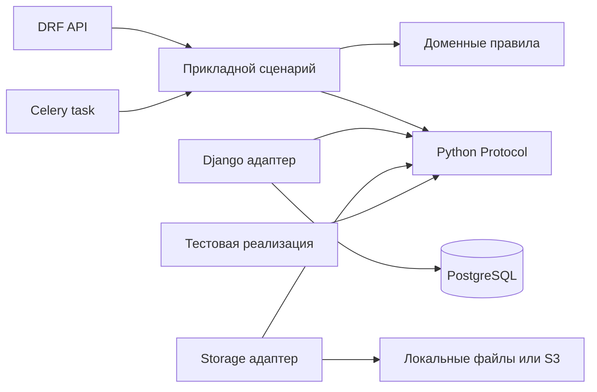

# Архитектура Tapme Flowers

Модульный монолит на Python 3.13 / Django 5.2 / DRF. Модули: `accounts`,
`businesses`, `customers`, `catalog`, `orders`, `payments`, `media`, `feedback`,
`reminders`; небольшое общее ядро `shared`.
Доставка пока является сценарием заказа, а не отдельным приложением с дублирующим
его состоянием. Отчёты и публичная страница находятся в модуле orders.

## Зависимости

- `domain.py`: обычные Python-типы, dataclass, правила сумм/статусов/напоминаний.
- `application/`: сценарии, полномочия, Protocol-интерфейсы, команды и результаты.
- `infrastructure/`: Django ORM, транзакции, Storage и конкретные запросы чтения.
- `models.py`, `migrations/`: детали постоянного хранения.
- `*_api.py`, `api.py`: DRF, валидация HTTP, преобразование ошибок и ответов.
- `config/composition.py`: сборка конкретных зависимостей, включая фоновые задачи.

Ядро не импортирует Django, ORM, HTTP, Celery или SDK хранилища; это проверяется
тестом импортов. Сценарии получают `Scope(user_id, business_id)` и проверяют
членство через `MembershipReader`. Стандартная авторизация Django остаётся
в accounts. Внутренний сценарий планировщика получает перечисление бизнесов
и репозиторий через composition root, отдельно от пользовательских разрешений.

Репозитории адаптируют ORM в dataclass/готовые результаты чтения. Сводка заказов
и история клиента используют отдельные read-порты; агрегации соседних модулей
остаются в адаптерах чтения. Взаимные записи заказов/оплат/фото выполняются
через их публичные контракты в общей транзакции.

## Заказ, транзакции и повтор запросов

Создание заказа сериализуется счётчиком внутри бизнеса. `Idempotency-Key` с UUID
и хеш команды защищают от повторного создания; повтор ключа с другой командой
даёт 409. Клиент и прайс читаются в рамках бизнеса, сервер рассчитывает Decimal-
сумму и сохраняет снимки названий/цен/контактов. Изменение прайса не меняет заказ.

WorkflowUnit/DjangoUnitOfWork открывает `transaction.atomic`; изменение заказа
берёт блокировку строки и проверяет переданную `version`. Потерянные обновления
возвращают 409. Два флориста не могут одновременно забрать свободный заказ.
Обычный путь: new → work → ready → route → done; самовывоз: ready → done.
Отмена требует причины; терминальные состояния нельзя произвольно возвращать назад.

Оплата/возврат хранится отдельной неизменяемой записью. Баланс считается под той же
блокировкой заказа: нельзя переплатить, вернуть больше оплаченного или уменьшить
заказ ниже остатка оплаты. Повтор платежа с прежним ключом возвращает прежнюю запись.
События назначения, изменений, оплаты, фото, жалобы и доставки доступны в истории.

| Роль | Доступ |
| --- | --- |
| Владелец | Офисные операции, настройки магазина, команда, сброс пароля сотрудника |
| Менеджер | Заказы, клиенты, прайс, назначения, оплаты, обращения, напоминания |
| Флорист | Свои задания и свободные новые заказы; сборка и фото букета |
| Курьер | Свои доставки; необходимые контакты получателя, фото и результат доставки |

Рабочие ответы флориста/курьера не содержат базу клиентов, покупательские контакты,
цены и финансовые данные. Проверки доступа повторяются при чтении файла и записи,
а не ограничиваются видимостью кнопок.

## Фото и смена хранилища

PhotoStorage задаёт сохранение/чтение/удаление байтов по ключу. Адаптер проверяет
изображение Pillow, ограничивает размер и разрешение, удаляет метаданные и
сохраняет JPEG. API пропускает PNG/JPEG/WebP до 10 МБ, до 20 фотографий заказа.

Файлы закрыты: браузер читает их через API с сессией и проверкой назначения.
Нет публичного `/media/`. По умолчанию Storage — FileSystemStorage, при
`TAPME_PHOTO_STORAGE=s3` — django-storages S3. Домен не знает bucket или SDK.
Смена backend требует переноса байтов с сохранением ключей и проверки доступа.

Если после загрузки не удалось сохранить метаданные, сервис удаляет загруженный
файл. После аварийного завершения процесса возможен сиротский файл: команда
`cleanup_orphan_photos` находит несвязанные файлы старше суток, `--apply` удаляет.
`export_photos` / `import_photos` сохраняют ключи при резервировании/восстановлении.

## Напоминания и внешние действия

Важные даты, согласие, жалобы, время магазина и история заказов — источник задач.
Правила выделены в чистый Python; адаптер выбирает записи и применяет их.
Уникальные ключи защищают от дублей при повторе Celery. Пропуск года подавляет
все оставшиеся интервалы данного события; новое годовое событие остаётся доступным.
Перед подготовкой текста и отметкой отправки доступность клиента проверяется снова.

Планировщик восстанавливает очередь из сохранённых фактов каждые 15 минут.
Он не отправляет сообщения. WhatsApp — ссылка с текстом и ручное подтверждение
сотрудником. Перед автоматической внешней отправкой потребуется outbox и адаптер
провайдера с подтверждениями доставки; сейчас такой интеграции нет.

## Публичный доступ и API

Токен заказа случайный; в БД хранится SHA-256. Ссылка перевыпускается/отзывается.
Публичный serializer явно ограничен номером, статусом, временем и контактами
магазина. Отзыв доступен один раз после вручения; низкая оценка создаёт жалобу,
которая приостанавливает напоминания клиенту.

API начинается с `/api/v1`. Группы: `auth`, `businesses/{id}/customers`,
`products`, `orders`, `tasks`, `settings`, `staff`, `reminders`, `reminder-rules`,
`overview`, а также `public/orders/{token}`. Точный контракт генерируется через
`manage.py spectacular`; авторизованный Swagger — `/api/docs/`.
Списки используют limit/offset, суммы передаются десятичными строками.
Изменяющие запросы защищены CSRF, в том числе отзыв без входа.

## Проверка заменяемости

Создание заказа проверяется с памятью и PostgreSQL; чистые правила запускаются
без Django. Интеграционные проверки покрывают транзакции, реальную конкуренцию,
изоляцию и роли. Полная подмена всех репозиториев другим backend не реализована:
при выборе другой БД нужны новый/адаптированный репозиторий, миграция данных,
индексы и повтор контрактных/конкурентных проверок. Это не переключатель настройки.

## Данные для интерфейса макета

`OrderDeskService` и `DirectoryService` обращаются к портам чтения; представления
API не вычисляют бизнес-правила в JavaScript. Адаптеры формируют показатели,
фильтры, календарь и задачи в рамках выбранного бизнеса. Короткие номера клиентов
выдаются отдельным счётчиком под блокировкой бизнеса; UUID остаётся ключом API.

`DeliverySlots` — порт расчёта и резервирования окна. PostgreSQL-адаптер блокирует
строку магазина внутри единицы работы заказа, проверяет вместимость и возвращает
цену. Цена доставки фиксируется в заказе; редактирование прежнего окна сохраняет
снимок, перенос пересчитывает его. Самовывоз может исключаться из лимита. Тест двух
одновременных запросов проверяет, что последнее место не продаётся дважды.

Позиции прайса архивируются без удаления. Новые заказы не принимают скрытую позицию;
ранее сохранённые строки сохраняют цену и остаются редактируемыми в рамках
доступных состояний заказа. Шаблоны допускают только фиксированный список простых
русских/английских подстановок, без обращения к атрибутам и форматирующих выражений.
