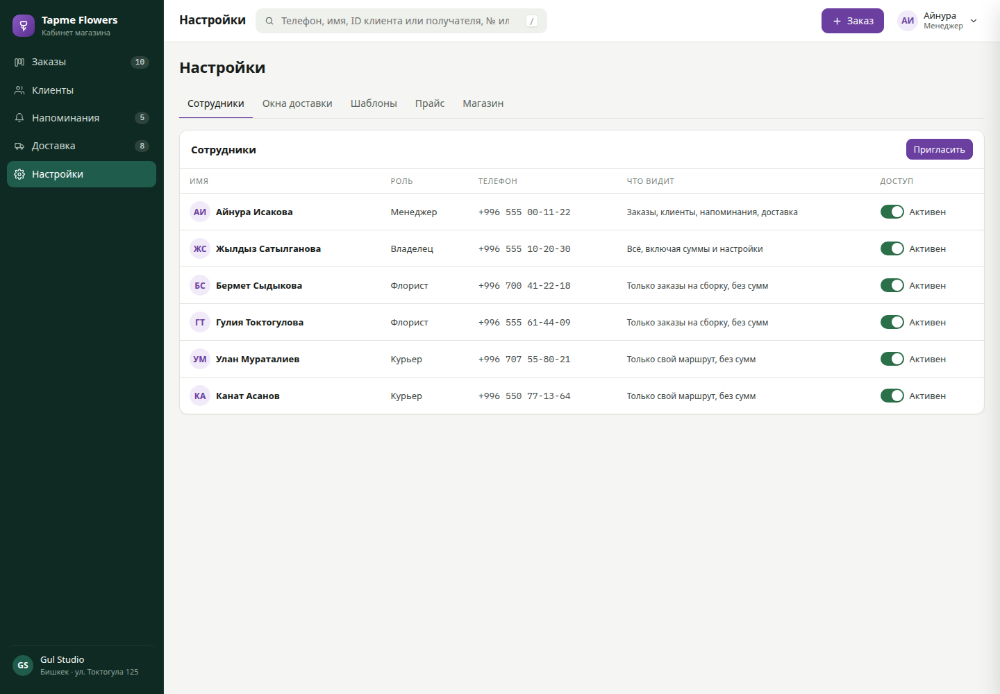
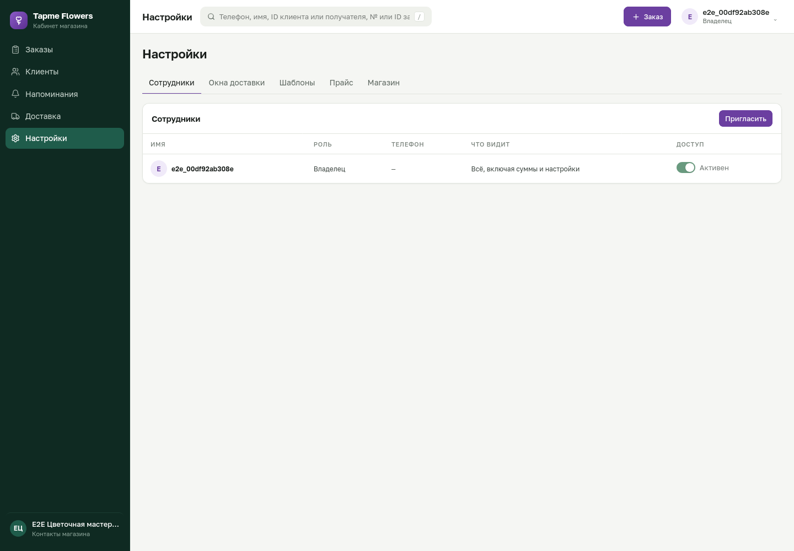
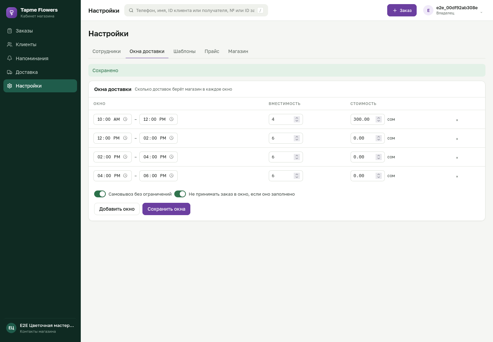

# Сверка с tapme-flowers-v1.html

22 сентября 2026. Перенос интерфейса по прямому запросу пользователя:
«Сверь полностью с макетом, чтобы точно так же было».
Исходный HTML не изменён. Демонстрационные клиенты и заказы не перенесены в рабочую базу.

## Что приведено к макету

| Область | Результат |
| --- | --- |
| Общий кабинет | Цвета, Golos Text / IBM Plex Mono, компактная навигация, логотип, шапка, меню пользователя. Шрифты поставляются локально. |
| Поиск | Общая строка на всех офисных экранах; поиск клиента/получателя/заказа по имени, телефону, ID и номеру; переход к найденной записи. Клавиша `/`, стрелки, Enter, Escape. |
| Настройки | Пять вкладок: Сотрудники, Окна доставки, Шаблоны, Прайс, Магазин. Таблицы, переключатели, карточки и сетка полей исходника. |
| Сотрудники | Роль, телефон, область доступа, действующее включение/отключение; приглашение создаёт учётную запись, пароль передаётся лично. |
| Окна доставки | Интервал, вместимость, стоимость, самовывоз без ограничений, запрет переполнения. Цена доставки фиксируется в заказе; бронирование защищено транзакцией. |
| Шаблоны | Все десять карточек из HTML, сохранение и русские подстановки. Старые индивидуальные тексты сохранены; очередь дат выбирает шаблон по числу оставшихся дней. |
| Прайс | Вкладка настроек, встроенная правка цены, добавление, скрытие и возврат из архива. Старые заказы сохраняют снимок цены. |
| Магазин | Название, город, адрес, телефон, WhatsApp, часы, валюта и ссылка; часовой пояс доступен в дополнительных настройках. |
| Заказы | Плитки, доска, список, календарь на три недели, время магазина, показатели, срезы, таймеры, панель задач и свои задачи. |
| Карточка заказа | Правая панель с этапами, реальными оплатами/возвратами, назначениями, фотографиями, обращениями и историей. |
| Форма заказа | Выбор/создание клиента, получатели, состав, доставка, стоимость окна, повод, источник и отношение получателя. Заказ из карточки предзаполнен. |
| Клиенты | Таблица с коротким постоянным ID, источником/метками, получателями, ближайшей датой и суммами; фильтры Все/VIP/Корпоративные/Новые/Давние. |
| Карточка клиента | Отдельная страница, показатели, получатели/даты, заказы, заметки, отзывы, сообщения; редактор открывается по действию. |
| Напоминания | Три показателя, фильтры и две группы строк; ручная подготовка сообщения и отметки сохраняются через API. |
| Доставка | По окнам и по курьерам, сегодня/завтра/дата, назначение курьера в строке. |
| Рабочие и публичные экраны | Общие цвета, карточки, типографика и этапы статуса; разграничение ролей и конфиденциальность сохранены. |

## Проверка

- 70 backend-тестов, включая конкурентное заполнение окна, снимок стоимости,
  архив прайса, поиск, изоляцию и десять шаблонов.
- 28 из них дополнительно запускаются без Django и базы данных.
- mypy: 37 файлов прикладного ядра и контрактов; Ruff, Django check, миграции,
  валидация OpenAPI и TypeScript/Vite build.
- Три E2E-сценария в Chromium и Firefox (6 проверок): создание заказа;
  полный рабочий цикл; сверка настроек, поиска, фильтров, архива, задач и размеров.
- Проверены ширины 390, 768 и 1440. Скриншоты ниже сделаны на изолированном
  тестовом магазине; его данные после теста удалены.

## Отличия рабочего продукта от демонстрации

Сверяется структура и оформление, а не значения демонстрационных счётчиков,
сотрудников, фотографий и дат. Нет заявления о побитовом совпадении скриншотов.
Нативные поля дат/времени зависят от браузера и системного языка.

У работающих форм есть сохранение, ошибки, загрузка, пагинация, дополнительные
действия и проверка прав. В первой версии валюта KGS. Нет фиктивных успешных
отправок WhatsApp, интеграции Яндекс Доставки или платёжного провайдера. Поэтому
карточка неподключённого Яндекса и кнопки мнимой внешней отправки не выводятся.
Автоматически действуют шаблоны очереди дат/давних клиентов; остальные шаблоны
сохранены для дальнейших сценариев уведомлений, без автоматической рассылки.
Публичная ссылка по прежнему договорённому контракту раскрывает только статус,
окно и магазин; приватные фотографии, адрес и клиентские контакты требуют входа.
Фото хранятся в локальном Docker-томе, S3 не включён.

Календарь исходного HTML содержит три недели; месячный календарь не требуется
для повторения этого макета. Ручное объединение дублей остаётся отдельной
возможностью после первой версии.

## Снимки

См. каталог `screenshots/`: исходный экран настроек, обновлённые настройки,
плитки, клиенты, напоминания, доставка и мобильный экран.

Исходный макет настроек:

Рабочий экран:

Окна доставки:

[Плитки заказов](screenshots/tiles.png) · [Клиенты](screenshots/clients.png) ·
[Карточка клиента](screenshots/client.png) · [Напоминания](screenshots/reminders.png) ·
[Доставка](screenshots/deliveries.png) · [Мобильный экран](screenshots/mobile-settings.png).
